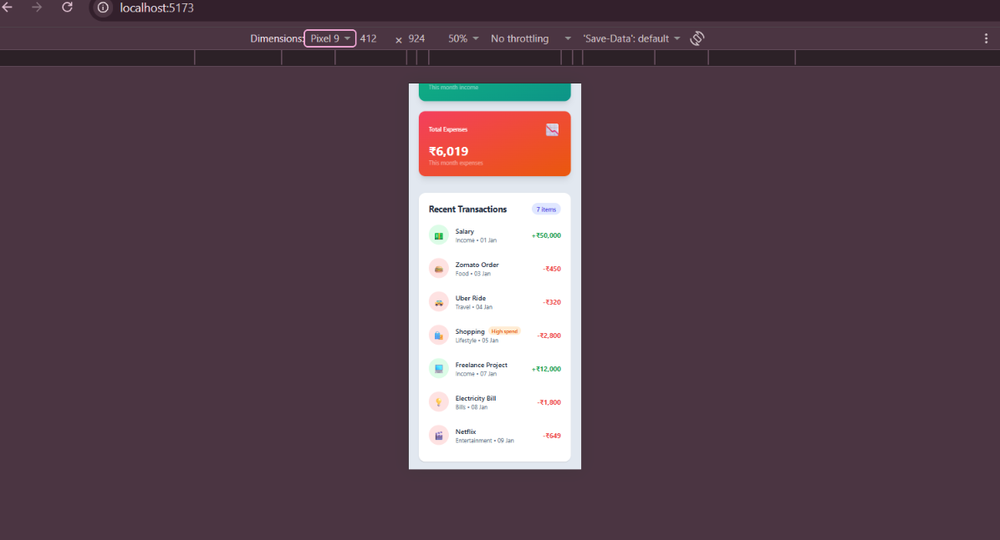

# 💰 Expense Tracker

A responsive expense tracker dashboard built with **React**, **Vite** and **Tailwind CSS** as part of my 7-day React learning challenge.

> 🚧 Work in progress. This project is built step by step while learning React from scratch.

## 🔗 Live Demo

Coming soon (will be deployed on Vercel/Netlify on Day 7)

## 📸 Screenshots

| Desktop | Mobile |
|---|---|
|  |  |

> Add your screenshots in a `screenshots/` folder in the repo.

## ✨ Features (so far)

- Responsive dashboard layout (mobile, tablet, desktop)
- Gradient navbar and animated summary cards
- Transactions rendered dynamically from an array using `map()`
- Totals (Balance, Income, Expenses) calculated automatically using `filter()` and `reduce()`
- "High spend" badge using conditional rendering
- Empty state UI when there are no transactions
- Amounts formatted in Indian currency style (e.g. ₹50,000)

## 🛠️ Tech Stack

| Technology | Purpose |
|---|---|
| React | UI library |
| Vite | Build tool and dev server |
| Tailwind CSS v3 | Utility-first styling |
| JavaScript (ES6+) | Logic |

## 📚 What I Learned

### Day 1: Setup
- What React is, Virtual DOM basics
- Setting up Vite + Tailwind CSS v3
- Project folder structure

### Day 2: JSX, Components and Props
- JSX rules and how it compiles to JavaScript
- Reusable function components
- Passing data with props, destructuring, default props
- One-way data flow (parent to child)
- Why Tailwind classes must not be built dynamically

### Day 3: Lists, Keys and Conditional Rendering
- Rendering lists with `map()`
- Why the `key` prop matters and why index is a poor key
- Conditional rendering: ternary, `&&`, early return
- The `count && <Component />` bug (renders `0`)
- Derived data with `filter()` and `reduce()`

## 📁 Project Structure

```
expense-tracker/
├── public/
├── src/
│   ├── components/
│   │   ├── Navbar.jsx
│   │   ├── SummaryCard.jsx
│   │   ├── TransactionItem.jsx
│   │   ├── TransactionList.jsx
│   │   └── Footer.jsx
│   ├── data/
│   │   └── transactions.js
│   ├── App.jsx
│   ├── main.jsx
│   └── index.css
├── index.html
├── tailwind.config.js
├── postcss.config.js
└── package.json
```

## 🚀 Getting Started

### Prerequisites
- Node.js 20.19+ (or 22.12+)
- npm

### Installation

```bash
# Clone the repository
git clone https://github.com/YOUR-USERNAME/expense-tracker-react.git

# Go to the project folder
cd expense-tracker-react

# Install dependencies
npm install

# Start the development server
npm run dev
```

Open `http://localhost:5173` in your browser.

## 🗺️ Roadmap

- [x] Day 1: Setup (Vite + Tailwind)
- [x] Day 2: JSX, Components, Props
- [x] Day 3: Lists, Keys, Conditional Rendering
- [ ] Day 4: Events and `useState` (add and delete expenses)
- [ ] Day 5: Forms, `useEffect`, localStorage
- [ ] Day 6: Lifting state up, Context API, React Router
- [ ] Day 7: Dark mode, polish, deployment

## 🤝 Connect

Learning in public. Follow my journey:

- LinkedIn:(https://www.linkedin.com/in/poonam-274843226/)
- GitHub: [@your-username](https://github.com/Poonam-D07)

---

⭐ If you like this project, consider giving it a star!
