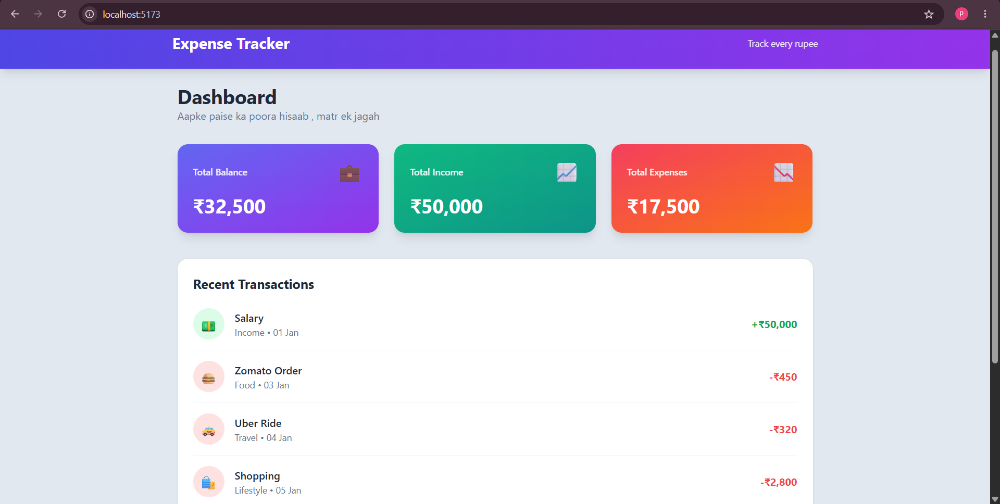
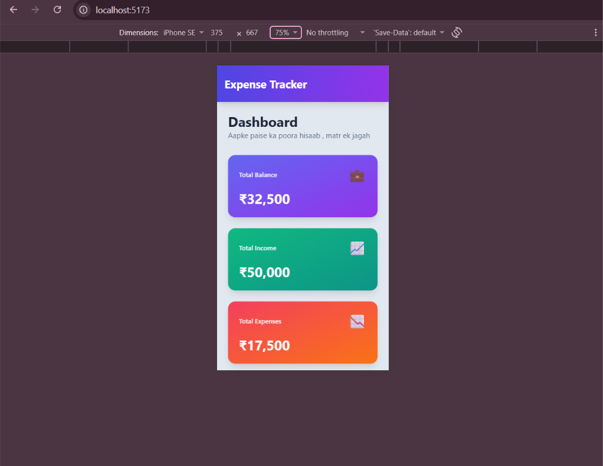
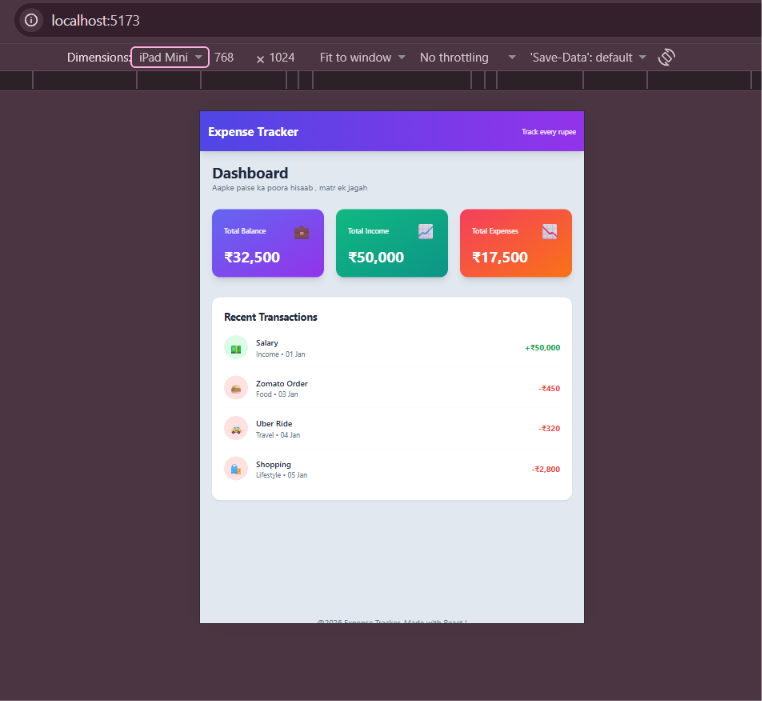

## 📚 Day 2 — Props & Reusable Components

### What I Learned

- **Props:** Passing data from a parent component to a child component.
- **Destructuring props:** `function SummaryCard({ title, amount })`.
- **Default props:** `type = "expense"` as a fallback value.
- **One-way data flow:** Data moves from parent to child only.
- **Reusable components:** One component used many times with different data.
- **Tailwind:** Gradients, grid, hover effects, responsive classes.

### 🧩 Example

```jsx
function SummaryCard({ title, amount, icon, gradient }) {
  return (
    <div className={`${gradient} rounded-2xl p-6 text-white shadow-lg`}>
      <p>{title}</p>
      <h2>₹{amount.toLocaleString("en-IN")}</h2>
    </div>
  );
}
```

### 🔍 How It Works

1. Parent (`App`) sends data: `<SummaryCard title="Income" amount={50000} />`
2. React packs it into an object: `{ title, amount }`
3. The child receives it and renders UI using that data.

### 📸 Screenshot

**Desktop View**



**Mobile View**



**iPad View**

